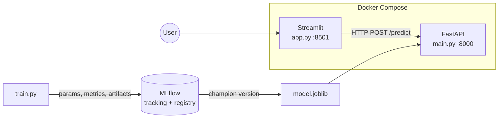

# SIS 3: ML System with FastAPI, Streamlit, MLflow and Docker

Continuation of Practical Task 6. The Iris classifier from PT6 is extended into a
complete ML system:

- **MLflow**: experiment tracking (parameters, metrics, artifacts) and Model Registry
- **FastAPI**: REST API serving the registered champion model
- **Streamlit**: web frontend for users
- **Docker Compose**: runs the API and the frontend as two connected containers

## Architecture



1. `train.py` trains several models; each one is logged as an MLflow run.
2. The best run (by macro F1) is registered as `IrisClassifier` and gets the alias `champion`.
3. The champion is exported to `model.joblib`, which the API loads.
4. The Streamlit frontend sends user input to the API and displays the prediction.

## Project structure

```
SIS3/
├── train.py              # training + MLflow tracking + model registration
├── main.py               # FastAPI: /, /predict, /model-info
├── app.py                # Streamlit frontend
├── model.joblib          # exported champion model
├── requirements.txt      # API dependencies
├── requirements-ui.txt   # frontend dependencies
├── Dockerfile            # API image
├── Dockerfile.ui         # frontend image
├── docker-compose.yml    # runs both services
├── .dockerignore
├── mlflow.db             # MLflow tracking + registry database (SQLite)
├── mlruns/               # MLflow artifacts
```

## MLflow

### Experiment tracking

Experiment: **`iris-classification`**. Each model is a separate run that logs:

- **Parameters:** model type and hyperparameters
- **Metrics:** accuracy, F1 (macro), precision (macro), recall (macro)
- **Artifacts:** MLflow model (`model/`) and the saved file `model.joblib`

| Run | Hyperparameters | Accuracy | F1 (macro) |
|---|---|---|---|
| logistic_regression | C=1.0, max_iter=200 | 0.967 | 0.967 |
| random_forest_small | n_estimators=50, max_depth=3 | 0.967 | 0.967 |
| random_forest_large | n_estimators=200, max_depth=None | 0.900 | 0.900 |
| **knn** | n_neighbors=5 | **1.000** | **1.000** |

### Model Registry

- Registered model name: **`IrisClassifier`**
- Version: **1** (from the `knn` run)
- Alias: **`champion`**, the version used in production
- Each new run of `train.py` registers a new version and moves the `champion` alias.

### Observations

- The **large random forest scored lowest**: with unlimited depth, its trees overfit
  the training data, while the depth-3 forest generalised better. Tracking several runs
  made this visible.
- The test set has only 30 samples, so the difference between 1.000 and 0.967 is a
  **single flower**. Another random split could change the ranking.
- The model always returns an answer, even for unrealistic inputs (e.g. petal width 2.5 cm
  with petal length 2.7 cm). In those cases the **confidence drops**, which is why the
  frontend displays it.

## API endpoints

| Method | Path | Description |
|---|---|---|
| GET | `/` | Health check |
| GET | `/model-info` | Registered model name, version, algorithm, MLflow run ID, metrics |
| POST | `/predict` | Predicted species, class probabilities and model version |
| GET | `/docs` | Swagger documentation |

## How to run

### 1. Train and register the model

```bash
pip install -r requirements.txt -r requirements-ui.txt mlflow
python train.py
```

### 2. View experiments in MLflow

```bash
mlflow ui --backend-store-uri sqlite:///mlflow.db --port 5000
```

Open http://127.0.0.1:5000 and switch to **Model training** mode.

### 3a. Run locally (two terminals)

```bash
uvicorn main:app --reload      # API: http://127.0.0.1:8000/docs
streamlit run app.py           # UI:  http://localhost:8501
```

### 3b. Run with Docker Compose

```bash
docker compose up --build -d
docker compose ps
```

- Frontend: http://localhost:8501
- API docs: http://localhost:8000/docs

Stop: `docker compose down`

Inside Docker, the frontend reaches the API by its service name: `API_URL=http://api:8000`.

## Model lifecycle

1. Change models or hyperparameters in `train.py` and run it.
2. MLflow logs the new runs and registers a new version of `IrisClassifier`.
3. The `champion` alias moves to the new version, and `model.joblib` is re-exported.
4. `docker compose up --build -d` rebuilds the API image with the new model.
5. The frontend sidebar shows the new version number.

## Training output

```
logistic_regression    accuracy=0.967  f1=0.967
random_forest_small    accuracy=0.967  f1=0.967
random_forest_large    accuracy=0.900  f1=0.900
knn                    accuracy=1.000  f1=1.000

Best model: knn (f1=1.000)
Successfully registered model 'IrisClassifier'.
Created version '1' of model 'IrisClassifier'.
Registered 'IrisClassifier' version 1
Alias 'champion' -> version 1
Exported champion to model.joblib
Registry champion predicts: setosa
```
